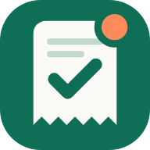
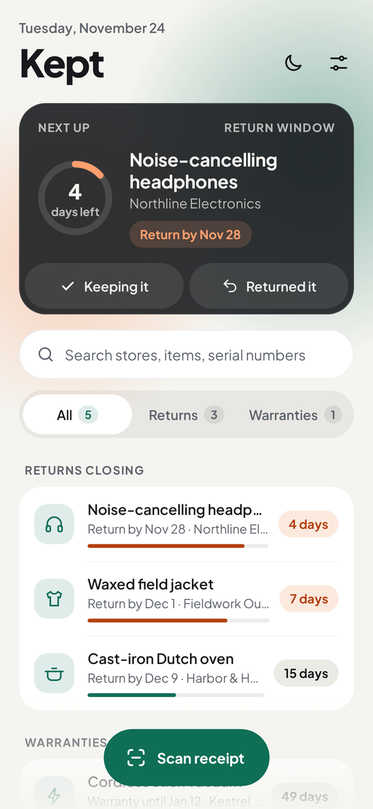
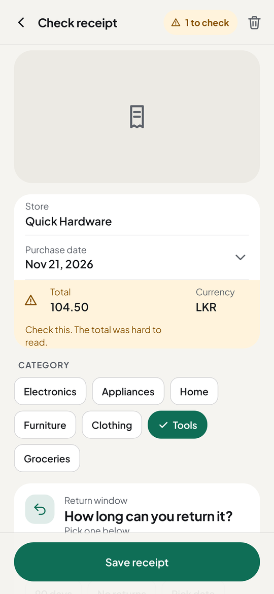
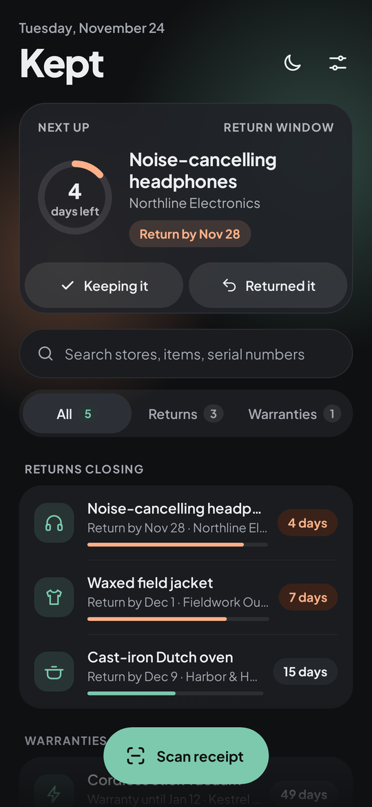
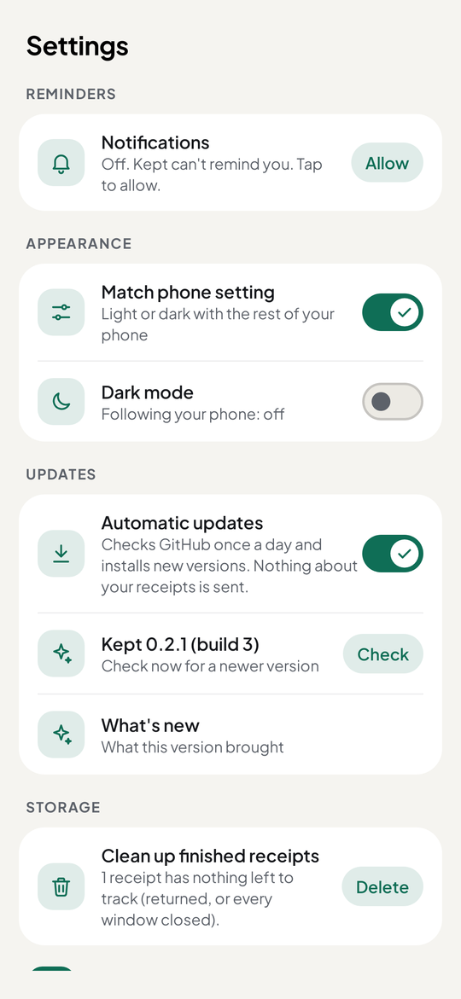

  

<h1 align="center">Kept</h1>

<b>Never miss a return or warranty again.</b> 
Snap a receipt. Kept reads it, works out when the return window closes and when the warranty ends,
and reminds you in time. Your receipts never leave your phone.

  <a href="https://github.com/kish523/kept-android/releases/latest"><b>Download Kept for Android</b></a>
  · Android 8.0 or later

  
  
  
  

## How it works

1. **Scan.** Tap **Scan receipt** and point your camera at it; the edges are found for you. You can
   also share a photo or a PDF to Kept, such as an order confirmation email.
2. **Check.** Kept reads the store, date, total and items, right on your phone. Anything it isn't
   sure about is highlighted so you can fix it in a tap. It works out the return window from the
   receipt, the store's policy or your pick, and the warranty from what came with it.
3. **Relax.** Kept reminds you 7, 3 and 1 day before a return window closes, and 30 and 7 days before
   a warranty ends. Answer straight from the notification: **Keeping it**, **Returned it**, or
   **Remind me tomorrow**.

Home always shows what's next: a countdown for the most urgent deadline, then everything else
sorted by date. Search by store, item or serial number. Swipe a receipt away when you're done with
it (with Undo). Light and dark mode included.

## Your receipts stay on your phone

Receipts say a lot about you: where you shop, what you buy, how much you spend. Kept is built so
that stays yours.

- **No account.** Nothing to sign up for. No email, no password, no profile.
- **No servers.** Kept has no backend, so there is nowhere for your receipts to be sent.
- **Read on your phone.** Photos are read on the device. The image and its text are never uploaded.
- **No cloud copy.** Kept opts out of Android's Google Drive backup. Moving to a new phone with
  Android's phone-to-phone transfer still brings your receipts along.
- **Card numbers masked.** If a full card number is printed on a receipt, Kept masks it the moment
  it's read and keeps only the last four digits.
- **No ads, and no analytics or trackers of our own.**
- **Locked down.** Published versions are signed release builds, so Kept's data can't be read out
  over a USB cable.
- **Check it yourself.** All of Kept's code is public, right here.

### Exactly what goes over the internet

| What | When | What's sent |
|---|---|---|
| Update check | At most every few hours while Kept is open, and once a day in the background. Can be turned off in **Settings › Updates**. | A request to GitHub for the list of Kept versions. Like any website, GitHub sees your IP address. Nothing about you or your receipts. |
| Update download | Only when a newer version exists | The new version of Kept, from GitHub. Kept checks it's genuine (same signature) before installing. |
| Google's ML Kit statistics | When a receipt is read | Kept reads text with Google's ML Kit, which runs on your phone. ML Kit sends Google statistics about itself, such as the phone model, app version and how long reading took. Never the photo, and never the text. See [Google's ML Kit data disclosure](https://developers.google.com/ml-kit/android-data-disclosure). |
| Google's document scanner | When you scan | The scanner runs on your phone inside Google Play services and hands the scan straight back to Kept. It's covered by Google's privacy policy. |

That's the complete list. Everything else, including your receipts, photos, reminders and
settings, stays on the phone.

### Permissions, and why

| Permission | Why Kept needs it |
|---|---|
| Notifications | To remind you. Kept asks after you save your first receipt, and you can say no. |
| Run at startup | To set your reminders again after the phone restarts. |
| Internet | For update checks and downloads (and Google's ML Kit statistics, above). |
| Install apps | So Kept can install its own updates. Android asks you before allowing it. |
| Wake lock, network state, foreground service | Added by Android's background-job library so the daily check runs reliably, and only with a connection. |

No camera permission (the scanner runs inside Google Play services), and no location, contacts,
photos, files or microphone.

## Install

1. On your phone, open the [latest release](https://github.com/kish523/kept-android/releases/latest)
   and tap the `.apk` file under **Assets**.
2. Open the download. If Android asks, allow your browser (or Files app) to install apps.
3. Tap **Install**, open Kept, and scan your first receipt.

Google Play Protect may say Kept is from an unrecognised developer. That's because Kept isn't on the
Play Store; you can install it anyway, and all of its code is public.

**Updates are automatic.** Kept checks once a day and downloads new versions by itself.

- **Android 12 and later:** after you allow it once, Kept installs updates in the background,
  usually when you leave the app.
- **Android 8 to 11:** these versions of Android don't let apps update themselves silently. Kept
  downloads the update in the background, and the next time you open Kept, Android asks you to tap
  **Install**.

After each update, Kept shows what's new.

## Questions

**Is Kept on the Play Store?** Not yet. Install it from this page for now.

**What if I lose my phone?** Your receipts are only on your phone, so they'd go with it. That's the
price of keeping them out of the cloud. A backup file you keep yourself (encrypted) is planned.
Moving to a new phone with Android's phone-to-phone transfer keeps everything.

**Does it work offline?** Yes. Everything works without a connection, except checking for updates.

**Which receipts can it read?** Printed receipts, photos and PDFs, in many layouts and currencies.
If one doesn't read well, you can fix the fields in a tap, and please
[tell us](https://github.com/kish523/kept-android/issues) so Kept can learn that layout.

**Found a problem or have an idea?** [Open an issue](https://github.com/kish523/kept-android/issues).

---

Building Kept yourself? See [docs/DEVELOPING.md](docs/DEVELOPING.md).
